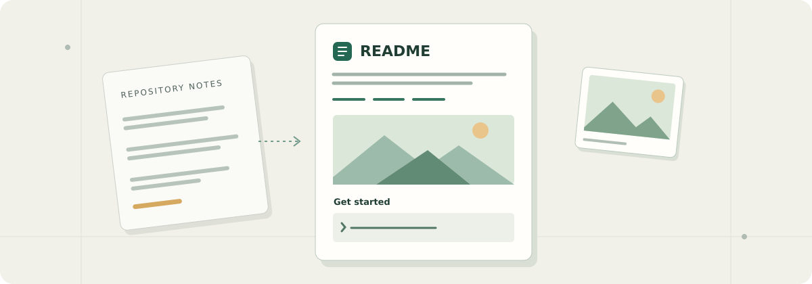

<h1 align="center">README Skill</h1>

<p align="center">
  <strong>Create and refine GitHub READMEs with your coding agent.</strong><br>
  Write useful documentation, prepare polished images,<br>
  and check the result against your repository.
</p>

<p align="center">
  <a href="#install">Get started</a> ·
  <a href="#usage">Usage</a> ·
  <a href="docs/usage.md">Tool guide</a> ·
  <a href="CONTRIBUTING.md">Contributing</a>
</p>

<p align="center">
  <a href="https://bun.sh"></a>
  <a href="LICENSE"></a>
  <a href="https://www.skills.sh/michidk/readme-skill/readme-skill"></a>
</p>

<p align="center">
  
</p>

Your coding agent reads the project, writes the README, and judges the result. The Bun toolkit supplies repeatable checks, image processing, and preview generation. Use shared standards across repositories while keeping each project's identity and requirements.

## Install

Requires **Bun 1.3 or newer**.

```sh
git clone https://github.com/michidk/readme-skill.git
cd readme-skill
bun install --frozen-lockfile
bun run install-skill
```

The installer copies the skill and runtime into `~/.codex/skills/readme-skill`, or `$CODEX_HOME/skills/readme-skill` when configured. Refresh your agent's skill discovery. See [installation options](docs/usage.md#installation-options) for Claude Code, custom destinations, and updates. The CLI also works directly from this checkout without installing the skill.

## Usage

Open the project you want to document and ask your agent:

> Use $readme-skill to refine this repository's README. Verify the first useful example, keep visuals restrained, and report what improved and what remains unverified.

Ask for **audit** to receive findings without edits, **refine** to improve an existing README, or **create** when the project has none. The result is a local diff of Markdown and any prepared assets, plus a verification report. The agent checks its claims against the repository and distinguishes verified examples from instructions it has only read.

Choose **very serious**, **neutral**, or **fancy** presentation. The skill asks when no preference is set; fancy mode can add subtle SVG separators. See [presentation styles](docs/usage.md#presentation-styles).

### Review linked documentation

The companion [docs-skill](skills/docs-skill/SKILL.md) reviews any repository Markdown, including guides linked from the README. It checks the audience, level of detail, factual support, and navigation without imposing README styling on every page.

```sh
bunx skills add michidk/readme-skill --skill docs-skill
```

> Use $docs-skill to refine the README and all locally linked documentation. Put normal user workflows first, keep advanced details discoverable, and report review coverage and verification gaps.

This instruction-only skill needs no toolkit runtime. The source installer above installs `readme-skill`; install the companion separately with the command here.

### Try the toolkit directly

This example prepares an editorial review brief for a small fixture. Run it from this checkout:

```sh
bun run cli review --root . --readme examples/review-input.md --json
```

The report locates headings, code examples, images, and links, then supplies questions for the agent's review. Use `inspect` to discover repository content and `check` to validate references and policy. See [command examples and exit codes](docs/usage.md#inspection-and-checks).

### Screenshots and video thumbnails

Resize a screenshot while preserving its aspect ratio:

```sh
bun run cli media screenshot.png --output docs/assets/screenshot.webp --width 800
```

Crop unwanted borders explicitly and use `--play` to add a play indicator to a video thumbnail. See [media examples](docs/usage.md#screenshots-and-video-thumbnails) for YouTube thumbnails and local video.

Your agent can also use its image-generation tools to create project artwork.

### Review and configuration

Use a shared policy for required sections, image budgets, and related repositories, with local overrides for individual projects. The toolkit can propose a GitHub description, homepage, and topics.

The preview command prepares HTML with narrow/wide layouts and light/dark backgrounds for review. See [configuration, previews, and metadata](docs/usage.md#review-and-configuration).

<a id="structured-graphics"></a>
The optional [HyperWeave integration](docs/usage.md#structured-graphics) renders static badges and small pipeline diagrams in an opaque light theme. Add a graphic only when it helps explain the project.

## Contributing

See [CONTRIBUTING.md](CONTRIBUTING.md) for development setup and tests.

## License

[MIT](LICENSE).
